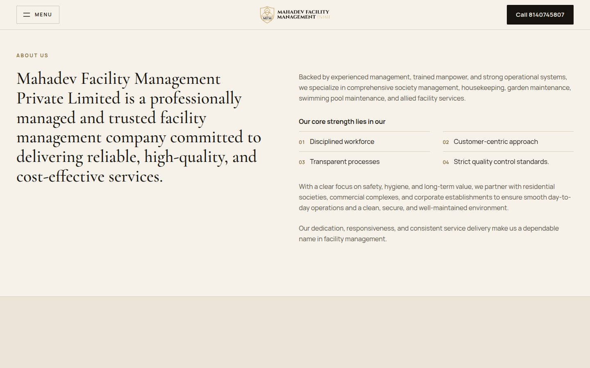
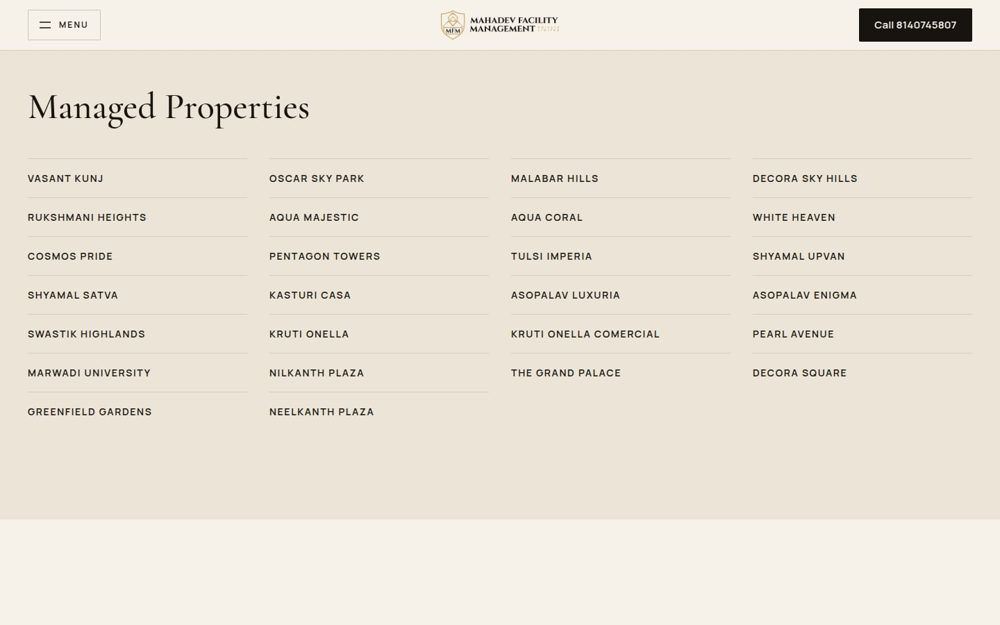
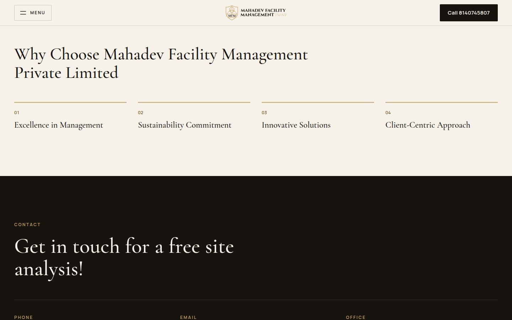
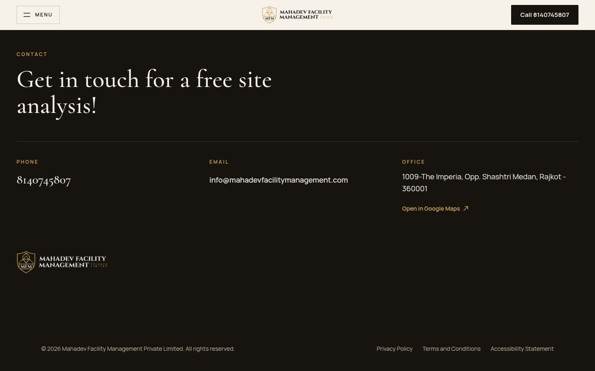
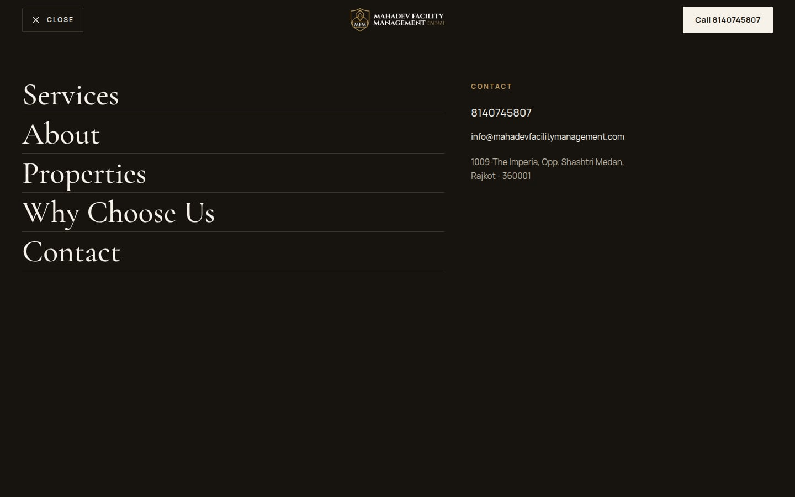
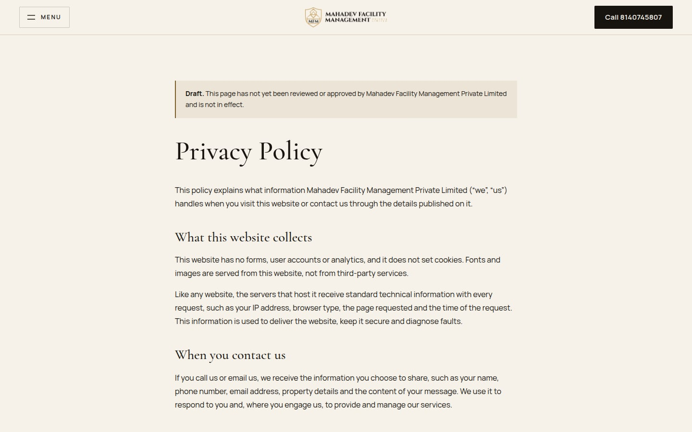
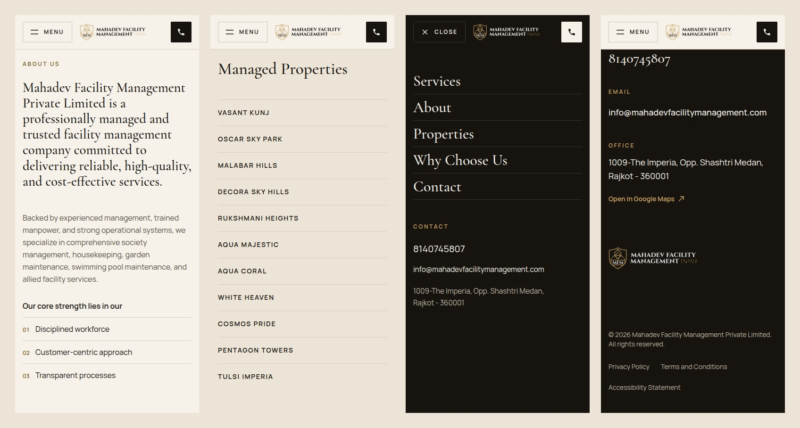

# Mahadev Facility Management website

> **Image permission.** The scroll journey uses six architectural visualisations of Oscar Sky Park from ishwargehi.com. Permission was confirmed in writing by the site owner on 2026-10-15; the rights holder's name and the credit wording are still to be added in `src/data/visuals.ts` and `docs/assets.md`.

Rebuild of www.mahadevfacilitymanagement.com (previously on Wix) as a Next.js site with a scroll-driven WebGL image journey through Oscar Sky Park, one of the properties the company manages, modelled on the reference recording described in `docs/reference-analysis.md`.

## Preview

Screenshots of the production build. The scroll journey at the top of the home page (Oscar Sky Park) is not pictured yet.

**Desktop (1440 px)**

| About | Managed Properties |
| --- | --- |
|  |  |
| **Why Choose Us** | **Contact and footer** |
|  |  |
| **Menu** | **Privacy Policy (draft)** |
|  |  |

**Mobile (390 px)**: About, Managed Properties, menu, Contact



To see the full site, including the scroll journey, run it locally (below).

## Run

```bash
npm install
npm run dev        # http://localhost:3000
npm run build      # production build
npm start          # serve the production build
npm run lint
npm run visuals    # regenerate AVIF/WebP journey images from assets/source
```

The optimised journey images in `public/visuals/` are committed, so a fresh clone and every Vercel build serve them as they are. The original downloads in `assets/source/` are not in git; `npm run visuals` (only needed to change sizes or quality) requires them there.

Requires Node 20 or newer. Set `NEXT_PUBLIC_SITE_URL` to the final origin (default `https://www.mahadevfacilitymanagement.com`); it is used for canonical URLs, Open Graph, the sitemap and structured data.

## Stack

| Package | Why |
| --- | --- |
| Next.js 16 (App Router), TypeScript | Static pages, metadata, image and font optimisation, redirects for old Wix URLs |
| Tailwind CSS 4 | Styling; brand colours are CSS variables in `src/app/globals.css` |
| three, @react-three/fiber | The journey's WebGL layer: real images on a full-frame quad with scroll-driven dolly, masked dissolves and a light grade |
| sharp (dev) | `npm run visuals`: converts the originals to sized AVIF and WebP |
| gsap, @gsap/react | One ScrollTrigger maps scroll position to the camera journey; `useGSAP` handles cleanup |
| motion | Mobile menu open and close transition |

Lenis was considered and left out; see `docs/animation-plan.md`.

## Where things are

- `src/lib/content.ts`: all copy, verbatim from the old site, plus contact details. Edit text here.
- `src/app/page.tsx`: home page sections.
- `src/data/visuals.ts`: every journey image (file, alt, credit, permission, crop) and the scroll beats. Swap images here only.
- `src/components/three/PhotoScene.tsx`: the WebGL image layer.
- `src/components/JourneyCanvas.tsx`: first-frame ``, WebGL hand-over, static fallback.
- `src/components/JourneyController.tsx`: scroll to camera and text mapping.
- `src/components/IntroOverlay.tsx`: loading line shown over the first image.
- `src/app/privacy-policy`, `terms-and-conditions`, `accessibility-statement`: legal pages (drafts).
- `docs/`: site inventory, audit, image sources and permissions, reference analysis, animation plan, design system, launch checklist, README screenshots (`docs/screenshots/`), old-site screenshots and original logo files.

## Before launch

See `docs/launch-checklist.md`.
